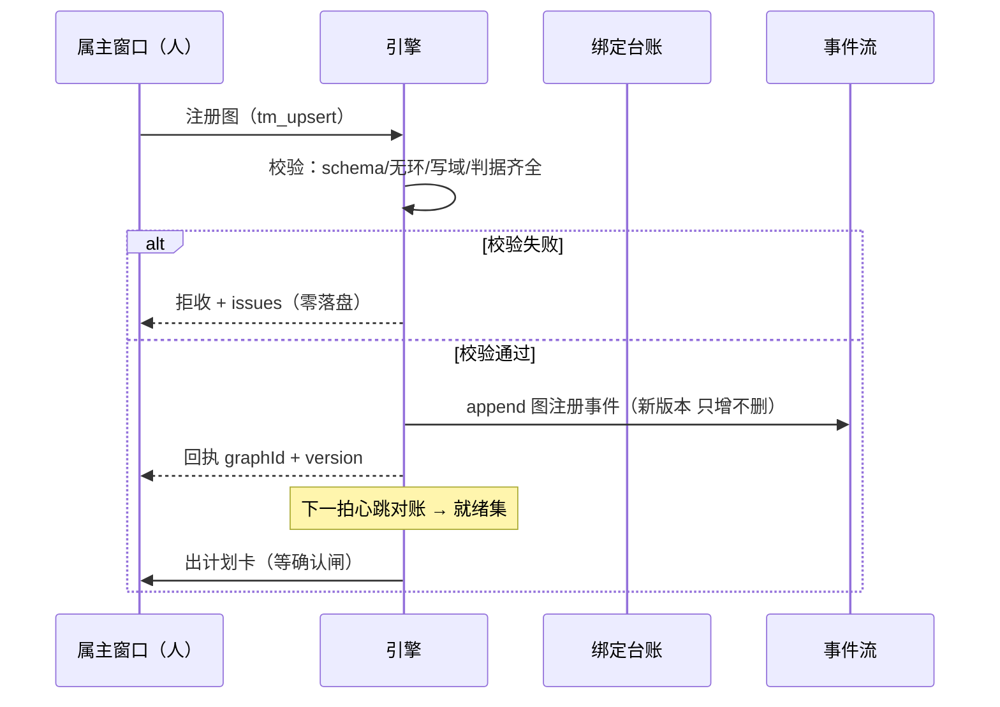
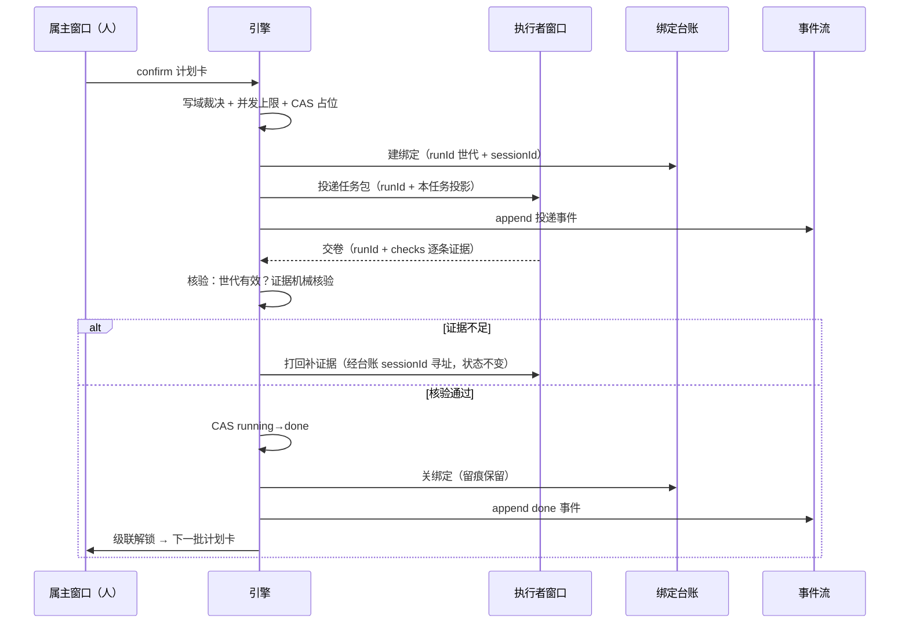
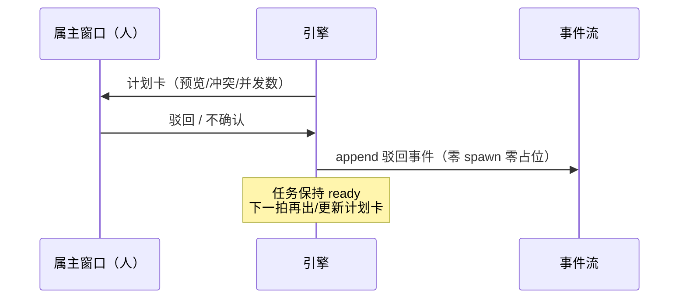
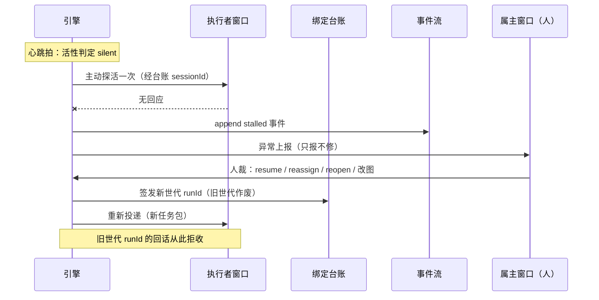
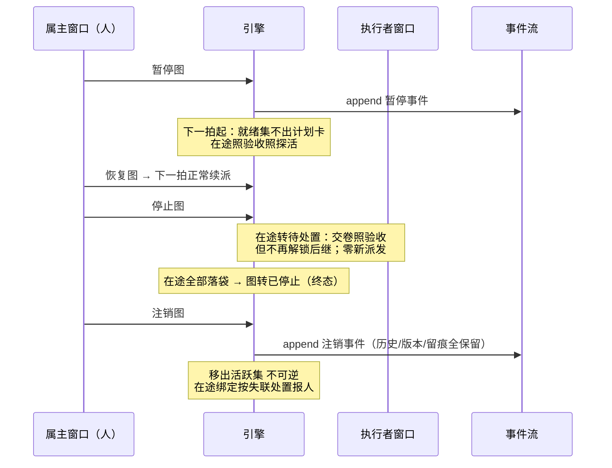
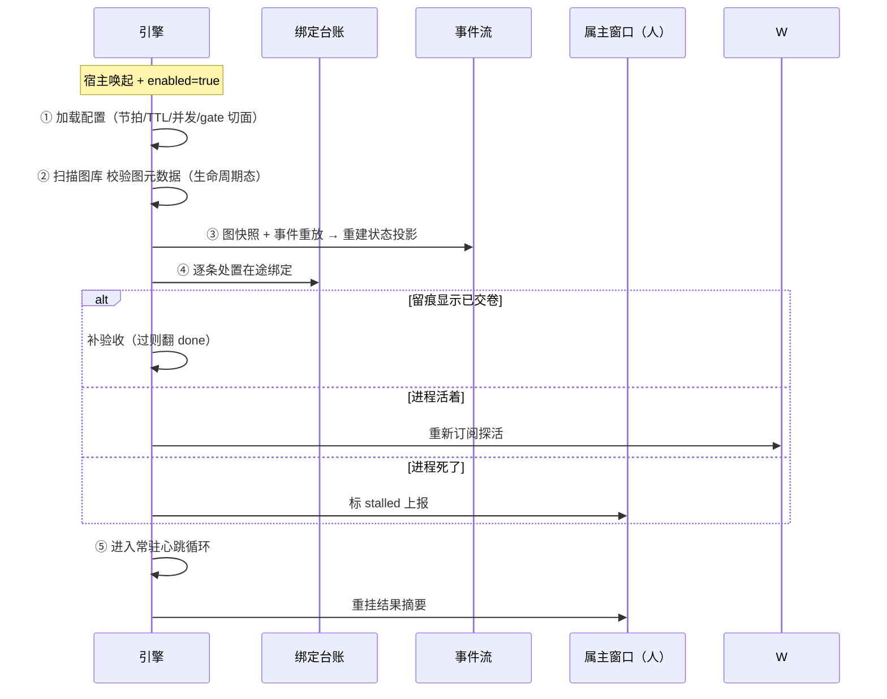

# Taskmaster（dsh-taskmaster）设计文档  serves: 全文

（本文是 Design Review 的评审对象，只回答「怎么做、为什么这么做、坏了怎么退」；需求与判据见 [PRD](../prd/taskmaster-prd.md)，不复述。）

## 摘要  serves: 全文

- **问题**：多步 agent 工作的派发、顺序、监控、验收全靠人客串，图落盘执行断档（PRD「背景与问题」）。
- **方案**：宿主插件级常驻引擎——注册版本化任务图为唯一事实源，心跳节拍全量对账，确认闸后 CAS 占位投递，绑定台账寻址探活与打回，异常只报不修。
- **影响面**：新增 dsh-taskmaster 插件（引擎 service + tm_* 工具面 + 持久化数据根）；依赖宿主插件生命周期与执行面（startActivation / window branch / spawnTeammate）；不改宿主。

## 背景与问题  serves: 全文

### 需求来源

| 需求编号 | 原始诉求 | 本设计如何回应 |
|---|---|---|
| FR-1 | 「DAG 生成交给控制面然后分发出去」 | 图注册 + 版本快照只增不删；注册校验拒收有环图 |
| FR-2 | 「分配 agent 执行不会跳步」 | 就绪计算是唯一派发入口：全部前驱 done 才进就绪集 |
| FR-4 | 「自主但不失控」 | 确认闸：计划卡全量曝光，不带 confirm 零 spawn |
| FR-5 | 「派发时每格只给该给的上下文」 | 任务包 = 本任务投影；执行者窗口同时刻仅一条活跃绑定 |
| FR-7 | 「我们需要一个任务探活能力」 | 三层活性信号 + alive→silent→stalled/dead 分级 |
| FR-8 | 「启动调度系统以后工作应该都交给调度系统来干活」 | 常驻心跳对账循环：事件是加速，心跳是兜底 |
| FR-10 | 「没看到驱动投递任务的能力」 | 投递独立成节：通道降级/at-most-once/失败回滚/留痕 |
| FR-11~13 | 「可以停止、注销等能力」 | 图级反向控制三档：暂停（可逆）/停止（收口）/注销（除名留史） |
| FR-14 | 「应该记录绑定到那个 agent 上吧，要不怎么投递消息」 | 在途绑定台账：四元组唯一 + sessionId 寻址 |
| NFR-4 | 「一个窗口对应一个图」「图可以对应多个窗口」 | 拓扑：属主 1:1、执行者 N:1、引擎:图 1:1、引擎寿命独立于窗口 |
| NFR-5 | 「持久化如何设计」 | 图快照+事件流为事实源；state/台账为可重建投影；单写者锁 |

（FR-3/6/9/15/16 与 NFR-1/2/3 的回应见「需求追溯」节，此表只列有会话原话的条目。）

### 现状与代价

见 [PRD「背景与问题」](../prd/taskmaster-prd.md)（不复述）。设计侧补一笔：atomize 拆解插件（PRJ-0001）拆完图无处投递，只能自己客串调度——本引擎是它的下游 service，也是它降级时的缺席兜底。

### 为什么是现在

宿主已有 dsh-schedule 先例证明插件级常驻服务形态可行（宿主级 service + 自管持久化域 + 定时自触发 + 重启恢复，见[可行性调研](../../research/taskmaster-resident-feasibility.md)）；需求方项目规模在涨，人客串调度的成本线性上升；排重结论确认与 dsh-schedule 零重叠，不存在"再等等看"的理由。

## 目标与非目标  serves: 全文

### 目标

- 注册图后零工具调用，一个心跳节拍内自动出计划卡（FR-8 可证伪）；
- 派发零跳步：任何触发路径（工具/心跳/重启续调）共享同一就绪计算（FR-2）；
- 卡死一个巡检周期内标 stalled 上报（FR-7）；
- kill 重启后在途 100% 重挂或如实标 stalled，不重复、不跳步（NFR-2）；
- 任何异常路径引擎零自动 spawn（NFR-1 红线，反向验证）。

### 非目标

- **不做拉模式认领与执行者池**（R-14 延期）：推模式 + 绑定台账已闭合一期链路；
- **不做网络面外部执行者**（R-15 延期）：一期本地进程内 service，接口按控制面/数据面划清即可平滑后补；
- **不做异常自动重跑/自修复**（R-16 永久拒绝）：写操作不幂等，自动重放不可逆；
- **不做执行者能力画像**：执行者对引擎是匿名可替换劳动力；
- **不做多写者协同**：同数据根单写者，多引擎 leader 选举留二期。

## 方案总览  serves: FR-8、FR-10、FR-14

**一句话方案**：一张版本化任务图 + 一条常驻心跳对账循环 + 一本绑定台账——每拍对账「期望=图，实际=state.json+台账」，差异即动作：该验收验收、该探活探活、该出计划卡出计划卡；人只在确认闸与异常点出现。

```text
属主窗口（人）
   |  注册图 / confirm / 人裁 / 暂停停止注销 / 看视图
   v
tm_* 工具面 --> 引擎 service（常驻）
   |              |-- 图库（版本快照，唯一事实源）
   |              |-- 心跳对账循环 --> 就绪计算 --> 确认闸 --> 写域裁决+并发上限
   |              |-- 验收（checks 机械核验）     |
   |              |-- 探活（三层信号分级）         v
   |              |-- 绑定台账（寻址）      CAS 占位 --> 投递 --> 执行者窗口 ×N
   |              v                                   |
   +------- 事件流（append-only） <------ 交卷+证据 ---+
   |
   v
数据根：graphs/ state/ bindings.json events/ runs/ reports/ .engine.lock
```

**关键概念**

- **任务图**：依赖偏序的任务集合，版本化，注册校验拒收有环图；
- **计划卡**：派发前的全量曝光（预览/冲突/并发数），确认闸的载体；
- **绑定**：一次投递建立的 (graphId, 图版本, taskId, runId) 记录 + sessionId 寻址，探活/打回/重挂的唯一依据；
- **世代**：runId 即世代凭据；人裁重派必发新世代，旧世代回话拒收；
- **活性投影**：alive/silent/stalled/dead 是只读投影，不进主状态机——状态翻转只走验收一条路；
- **六条主流程时序**（注册激活/正常闭环/确认闸驳回/异常人裁/暂停停止注销/重启续调）见附录。

## 架构与依赖  serves: FR-8、FR-15、NFR-4

- **模块划分**
  - `graph-store`：图版本注册/校验/回读（无环校验在注册期）；
  - `reconciler`：常驻心跳循环，全量对账，产出动作集合；
  - `scheduler`：就绪计算 → 写域裁决 → 并发上限 → 计划卡生成；
  - `gate`：确认闸（计划卡幂等更新、confirm 接收、gate=auto 切面）；
  - `deliverer`：通道探测与降级（startActivation → window branch → spawnTeammate → 纯对话流）、CAS 占位、失败回滚、投递留痕；
  - `binder`：绑定台账（建/关/查/重挂），世代凭据签发与校验；
  - `acceptor`：交卷接收、世代校验、checks 机械核验、CAS 翻 done、打回；
  - `monitor`：三层活性信号采集、分级、主动探活、dead 补验收、死锁检测；
  - `persister`：事件流 append、原子写、CAS、崩溃重建、单写者锁；
  - `statuser`：量化视图投影（tm_status 的唯一数据源）；
  - `tools/`：tm_* 工具面（人/agent 的入口，非派发触发源）。
- **依赖方向**：`tools → service{reconciler, gate, acceptor} → {scheduler, deliverer, monitor} → binder/persister → graph-store`；`statuser` 只读。**无环**；事件流只 append 不回读在线状态（重建除外）。
- **外部依赖**：宿主插件生命周期（常驻驻留，阻塞项）；宿主执行面三档通道（至少一档可用，否则降级纯对话流）；宿主事件回调（加速用，丢失由心跳兜底）。
- **与既有架构的差异**：引擎行为依赖工作区数据根（`.dsh/taskmaster/`）——驻留形态与 dsh-schedule 同构（宿主级 service + 自管持久化域），差异在多了执行面写入（spawn）与数据根单写者锁。

## 数据模型  serves: FR-1、FR-14、NFR-5

- **实体与字段**
  - `Graph@v`：tasks[]（id/陈述/checks/写域/回合预算/前置边/kind/story/里程碑/expansion(atomic|expanded)/outputs[{name,kind:file|check|value,path?}]）；meta（graphId/version/created）。
  - `Binding`：graphId / graphVersion / taskId / runId（世代）/ sessionId / channel / dispatchedAt / startedAt / lastEventSeq / state(active|closed)。
  - `Event`：seq（单调）/ ts / graphId / taskId? / kind（register|dispatch|submit|accept|reject|stall|dead|pause|resume|stop|deregister|verdict…）/ payload 摘要。
  - `StateProjection`：taskId → status（pending/ready/planned/dispatching/running/blocked/done）+ 待处置标记；**可重建，不是事实源**。
  - `GraphMeta`：graphId → 活跃版本 + 生命周期态（active/paused/stopping/stopped/asleep/deregistered）。
- **约束与不变量**
  - 图版本只增不删；在途任务绑定派发时的版本快照；
  - 绑定四元组 (graphId, graphVersion, taskId, runId) 唯一；任务同时刻 ≤1 条活跃绑定（CAS 占位）；同一 sessionId 不出现在两条活跃绑定；
  - 事件 seq 单调递增（探活"留痕心跳"同源）；原地写一律临时文件 + rename + 版本 CAS；
  - 拓扑：属主窗口:图 = 1:1；执行者窗口:图 = N:1；任何窗口同时刻只服务一张图；引擎:数据根 = 1:1（`.engine.lock` 单写者）。
- **目录布局**

```text
.dsh/taskmaster/
├── config.yaml            # enabled/节拍/TTL/并发上限/gate 切面
├── .engine.lock           # 单写者锁
├── graphs/<graphId>/vN.yaml + meta.json     # 事实源
├── state/<graphId>.state.json               # 可重建投影
├── bindings.json          # 在途绑定台账
├── events/<graphId>.events.ndjson           # 事实源（append-only）
├── runs/<runId>/delivery.json               # 投递留痕（永久）
└── reports/               # 异常上报（stalled/dead/死锁）
```

- **迁移与回填**：无存量（新插件）；graphId 命名空间预留，二期网络面不破坏布局。
- **生命周期**：图版本/事件流/runs 永久保留（注销也不删）；state 可删可重建；bindings.json 终态即清除条目（留痕在 runs/）。

## 接口设计  serves: FR-1、FR-4、FR-6、FR-9、FR-10、FR-11、FR-12、FR-13、FR-15、FR-16

| 编号 | 接口 | 输入 | 输出 | 失败与错误 | 兼容性 |
|---|---|---|---|---|---|
| IF-1 | `tm_upsert`（注册/改图） | graphId?、图 YAML | graphId + version；或 issues | 校验失败（含环图）→ `invalid-graph`，零落盘 | 图 schema 只增字段；未知键报错不忽略 |
| IF-2 | `tm_confirm`（确认闸） | graphId、planId、confirm、批注? | 派发回执（runId 列表）或驳回留痕 | 计划卡过期 → `plan-stale`（重出卡） | 计划卡带世代，旧卡 confirm 无效 |
| IF-3 | `tm_node_update`（交卷/blocked） | runId、taskId、checks 证据 / blocked 原因 | 验收回执（过/打回/已收） | 世代失效 → `stale-run` 拒收；证据不足 → `evidence-insufficient` 打回 | 只认当前世代 runId |
| IF-4 | `tm_status`（视图） | graphId?、group_by?、taskId? | 投影（计数/波次/等待关系/生命周期态/活性） | 无（只读不失败） | 投影字段只增不减 |
| IF-5 | `tm_graph_ctl`（暂停/恢复/停止/注销） | graphId、action | 新生命周期态 | 非法迁移（如 stopped→active）→ `bad-transition`；注销二次确认 | action 集合只增；注销语义永不可逆 |
| IF-6 | `tm_task_action`（人裁） | taskId、action(resume/reassign/reopen)、理由 | 新世代 runId / 新状态 | 非人裁入口调用 → 拒绝；running 任务 reopen → `bad-state` | 全部留痕；action 集合只增 |
| IF-7 | `tm_engine_stop`（引擎停止，S2） | 无 | 引擎态 stopped | 已在 stopped → 幂等成功 | S2 新增，不影响既有工具 |
| IF-8 | 投递通道适配（内部） | 任务包 + 通道优先级 | sessionId + 通道 / 降级结果 | 三档全不可用 → 转纯对话流出计划卡 | 通道实现可插拔，优先级可配 |

#### IF-1 tm_upsert

**语义**

图的唯一写入口：schema 校验 → 语义校验（无环/写域/判据齐全）→ 版本快照落盘。全部通过才落盘，不存在部分写入。在途任务继续按派发时快照跑，新派发用新版本。

**错误码**

`invalid-graph`（issues 逐条指向 tasks[i]/edges[j]）/ `graph-not-found`（改图时 graphId 不存在）/ `write-conflict`（并发注册，CAS 失败重试）。

**兼容性**

图 YAML schema 字段只增；v 内行为不变，跨版本靠快照隔离。

#### IF-2 tm_confirm

**语义**

确认闸的人侧入口。计划卡幂等更新（同一批就绪重复出卡只更新不刷屏）；confirm 触发 scheduler → deliverer 链；驳回只留痕，任务保持 ready。

**错误码**

`plan-stale`（卡对应就绪集已变，重出卡）/ `gate-disabled`（引擎降级中，只出卡不派发）。

**兼容性**

计划卡内含图版本与就绪集哈希，confirm 时校验——这是"按派发时快照"的闸侧实现。

#### IF-3 tm_node_update

**语义**

执行者的唯一回向接口：交卷（checks 逐条证据）或报 blocked。引擎先校验世代（runId 必须等于台账当前世代），再机械核验；过 → CAS 翻 done → 关绑定 → 级联解锁；不过 → 打回（经 sessionId 寻址），状态不变。

**错误码**

`stale-run`（世代失效，拒收）/ `evidence-insufficient`（打回，附缺哪条）/ `not-running`（任务非 running）。

**兼容性**

证据格式 checks[] 只增字段；打回文本协议稳定（执行者 prompt 依赖它）。

**幂等与重试**

同一 runId 重复交卷：首次已翻 done 后重交 → 幂等返回"已验收"，不重复级联。blocked 幂等同理。

#### IF-4 tm_status

**语义**

唯一查询入口，全部从图 + 投影 + 台账派生，无第二事实源；含图生命周期态与任务待处置态。

**错误码**

只读接口不失败；graphId 不存在 → 空结果 + notice。

**兼容性**

输出字段只增不减（视图消费者依赖字段稳定）。

#### IF-5 tm_graph_ctl

**语义**

图级反向控制三档：pause（可逆，停派不停收）/ stop（在途转待处置，落袋后终态）/ deregister（除名留史，不可逆，二次确认）。非法迁移拒绝。

**错误码**

`bad-transition` / `confirm-required`（deregister 未带二次确认）。

**兼容性**

生命周期态集合冻结（active/paused/stopping/stopped/asleep/deregistered）；新增态 = 设计评审事项。

#### IF-6 tm_task_action

**语义**

人裁入口（resume/reassign/reopen）：全部签发新世代 runId、旧绑定关闭、重投递走标准投递链。引擎自身任何路径都调不到它——这是"恢复动作全部由人发起"的物理保证。

**错误码**

`bad-state` / `authority-required`（非属主窗口发起）。

**兼容性**

action 集合只增；每次人裁在 events/ 落痕（谁、何时、什么动作、理由）。

#### IF-7 tm_engine_stop（S2）

**语义**

运行态停止：心跳停、零派发零探活；在途不杀；再启动走 Boot ④重挂。与 `taskmaster.enabled`（配置态禁用）语义分立。

**错误码**

幂等：重复停止返回当前态。

**兼容性**

S2 新增；S1 期用 enabled 开关近似。

#### IF-8 投递通道适配

**语义**

内部接口：按优先级探测通道可用性并投递任务包，返回 sessionId + 实际通道；三档全不可用转纯对话流（计划卡由人手工带任务包开工）。CAS 占位先于投递，失败回滚不自动重试。

宿主源码已确认的两个契约（[调研 v0.3](../../research/taskmaster-resident-feasibility.md) E-9）：

- **结果回报**：订阅 `subagent/start` / `subagent/end` 生命周期事件（宿主事件总线），`subagent/end` 携带执行结果——引擎无需身处会话即可收卷；交卷契约借 `request.outputSchema` 结构化输出承载 checks 证据（支撑 FR-6 机械核验）；
- **父体约束**：spawn / startActivation 两档要求 **exact live parent agent**（否则 UNAUTHORIZED）——属主窗口关闭期间这两档不可用，自动降级 branch 档或排队等属主回来（补投纪律不变）；探活/打回经 `sendMessage` 寻址驻留子会话。

**错误码**

`channel-unavailable`（逐档降级）/ `delivery-failed`（回滚占位、留痕、任务回就绪）。

**兼容性**

通道实现可插拔；优先级配置化；新增通道不改动 deliverer 主流程。

## 备选方案  serves: 全文

| 方案 | 一句话说明 | 优点 | 代价 | 为什么未选 |
|---|---|---|---|---|
| A（选用） | 常驻引擎 + 心跳对账 + 绑定台账 + 确认闸 | 监控/验收/续调闭环；人不客串调度 | 引擎与持久化纪律要自建，抽象成本前置 | — |
| B | 纯工具形态（无常驻循环） | 实现最省 | 监控/续调退化为人记得调 | 需求原话"不是工具性质的"；R-2/R-7/R-9 全部落空 |
| C | 复用 dsh-schedule 定时器 | 零新组件 | 按时间调度，依赖语义无处安放 | 排重结论已写明零重叠，硬套语义错位 |
| D | 多引擎协同（每窗口独立引擎 + 共享裁决） | 窗口隔离更彻底 | 需 leader 选举/共享锁，复杂度二期量级 | 一期单写者已够；列为开放问题二期再议 |
| E：什么都不做 | 人继续客串调度 | 零成本 | 四痛点随规模线性放大 | 会话证据已反复出现 |

## 四风险与证据  serves: 全文

| 风险类型 | 判断问题 | 现有证据 | 结论 |
|---|---|---|---|
| 价值 | 属主真的愿意过确认闸吗 | 会话原话"自主但不失控"；M1 真实项目 3~5 任务跑通看驳回率（未做） | 部分 |
| 可用性 | 计划卡/上报/打回的文本交互人会用吗 | PRD 文本交互原型三段；M1 走查脚本 13 步（未跑） | 部分 |
| 可行性 | 常驻引擎形态建得出来吗 | dsh-schedule 先例（宿主级常驻 + 持久化域 + CAS + 定时自触发 + 重启恢复）；详见[常驻形态可行性调研](../../research/taskmaster-resident-feasibility.md)：D-1 采纳（v0.2：startActivation/spawn 的 service 级可调已由官方文档确认）。注意：goal-round-driver 与本引擎语义不同（会话内续跑 vs 跨执行者派发），不作先例 | 已验证（源码级：E-9 确认生命周期事件收卷 + live parent 约束已落 IF-8；残余项 = 大图节拍耗时，M1 基准） |
| 商业可行性 | 成本与合规能接受吗 | 纯本地、零网络；spawn 成本由确认闸+并发上限控制 | 已验证 |

**未验证项的补课计划**：价值与可用性 → M1 走查（2026-11-08 前）看计划卡驳回率（阈值 30%）；可行性 → M1 代码验证宿主插件常驻 + 心跳循环，失败则退回方案 B 并复盘。

## 失败模式与回滚  serves: NFR-1、NFR-2、NFR-3、NFR-5

| 失败场景 | 触发条件 | 用户可见影响 | 检测手段 | 回滚动作 | 决策人 |
|---|---|---|---|---|---|
| 事件丢失 | 完成回调未到达 | 无（下一拍对账兜底） | 心跳对账差异 | 自动对账纠正（读路径，非重跑） | 引擎 |
| 投递失败 | 通道不可用/超时 | 任务回就绪，计划卡重出 | runs/ 留痕 + 上报 | 人确认下一批计划卡 | 属主 |
| 执行者卡死 | idle 不交卷 | 一个周期内 stalled 上报 | 三层活性信号 | 人裁（resume/reassign/reopen） | 属主 |
| 执行者窗口死亡 | 进程消失 | dead 上报；有交卷留痕则补验收 | 进程存活信号 | 人裁 | 属主 |
| 属主窗口关闭 | 窗口被关 | 计划卡/上报排队；spawn/activation 档不可用（需 live parent），自动降级 branch 档或等重开补投 | 投递目标探测 | 自动降级 + 排队补投 | 引擎 |
| 死锁 | 就绪集空图未完 | 上报，零动作 | 对账巡检 | 人改图或人裁 | 属主 |
| state.json 损坏 | 写中断/磁盘错 | 重启时投影重建 | 启动校验 | 快照+事件重放重建 | 引擎 |
| 台账损坏 | 写中断 | 在途任务寻址丢失 | 启动校验 | 从 runs/ 留痕重建台账；建不全的标 stalled 报人 | 属主 |
| 双引擎写同数据根 | 误启动第二实例 | CAS 混乱风险 | `.engine.lock` 拒绝启动 | 锁拒绝 + 报错 | 引擎 |
| 误注销图 | 人误操作 | 图除名不可恢复 | 二次确认（confirm-required） | 无回滚——注册新版本重来 | 属主 |

- **开关**：`taskmaster.enabled`（全局，默认 false）；`gate=auto` 切面（里程碑粒度）；并发上限（S1 固定 1）。
- **回滚演练**：M1 走查含"关开关零 spawn"与"kill 重启续调"两步；预期 1 分钟内停派。
- **不可逆动作**：图注销（二次确认 + 历史全留可审计）；人裁重派（新世代，旧世代回话即拒，但已产生的业务写入不撤——这正是不自动重跑的原因）。

## 监控自愈（autoResume）  serves: FR-7、NFR-1、NFR-3

「异常只报不修（R-8）」是缺省行为；本节描述其**唯一例外**：`autoResume.enabled` 显式开启后，死判（dead）任务由引擎自动续跑，直至自愈额度耗尽落 blocked 等人裁。缺省关闭，不改变现状行为。

### 状态机：死判 → auto-resume → 超上限 blocked

活性是投影、不进主状态机；自愈动作发生在「新判 dead」这一拍（去重：同人裁不重复上报，同一绑定不重复自愈）：

```
进程存活信号 = false
        │
        ▼
   dead 标记（append dead 事件 + reports/ 落盘）
        │
        ├─ autoResume.enabled = false ──► 停：只报不修，等人裁（IF-6）
        │
        ▼
自愈计数 count = 事件流中本任务 task-resume(auto:true) 条数
        │
        ├─ count < maxPerTask ──► auto-resume：
        │     ① binder.supersede 关旧绑定（旧世代 runId 作废，回话即 stale-run 拒收）
        │     ② 投影 CAS 翻 ready + runId=null（新世代由下一拍派发链签发）
        │     ③ append task-resume 事件（auto:true / actor:"auto-resume" / count / maxPerTask）
        │     ④ 崩溃重建走既有 fold 重放成 ready——零漂移、无需改引擎模块
        │
        └─ count ≥ maxPerTask ──► blocked：
              ① 投影 CAS 翻 blocked（blockReason 写明额度耗尽）
              ② append blocked 事件 + reports/ 落盘（绑定保留）
              ③ 回到「只报不修」，等人裁 resume/reassign
```

为什么只自愈 dead 不自愈 stalled：dead 的进程存活信号为 false，执行者已确定不可能再交卷，重派零业务风险；stalled 的执行者可能仍在工作，重派会造成双写——必须等人裁。

### 配置项（config.yaml）

| 字段 | 缺省 | 说明 |
|---|---|---|
| `autoResume.enabled` | `false` | 自愈总开关；缺省关闭 = 纯上报的现状行为 |
| `autoResume.maxPerTask` | `2` | 单任务自愈额度上限；加载时钳制到 0..8，非数字回退缺省 |

加载纪律：浅合并会整体覆盖缺省对象，须逐字段回填；Monitor 缺省每拍从 config.yaml 重读，改配置下一拍生效（构造注入可固定，供测试）。

### 与 tm_task_action（IF-6）人工路径的关系

- **同语义**：auto-resume 是 IF-6 人裁 resume 语义的自动化特例——同样关旧世代（supersede）、翻 ready、走标准派发链签发新世代，**绝不自动重放写请求**（NFR-1 红线不破）。
- **可区分**：事件 kind 复用 `task-resume`，但自愈带 `auto:true / actor:"auto-resume"`；自愈计数只统计 `auto:true`，**人裁 resume 不占自愈额度**。
- **互补不自洽**：超上限落 blocked 后，出口只有 IF-6 人裁；人裁 resume 后若再次死亡且额度仍耗尽，依然落 blocked——引擎永远不会绕过额度把人裁架空。

## 跨关注点  serves: NFR-1、NFR-3、NFR-5

| 关注点 | 结论 | 依据与措施 |
|---|---|---|
| 安全 | 执行者视野最小化；引擎不自动重放写操作 | 任务包投影 + 绑定基数约束；NFR-1 红线 + 人裁唯一入口（IF-6） |
| 隐私与合规 | 数据不出工作区 | 全部落 `.dsh/taskmaster/`；零网络；留痕含任务陈述与证据摘要，无凭证字段 |
| 成本 | spawn 受闸与并发上限控制 | 计划卡全量曝光 + S1 串行；心跳空转成本 ≈ 每拍一次目录扫描 |
| 可观测性 | 事件流即审计日志 | append-only events/；reports/ 收异常；tm_status 只读投影 |
| 性能与容量 | 一期规模：单图 ≤ 数百任务 | 文件持久化足够；每拍成本 O(任务数)；SQLite 留二期选项 |
| 文档与支持 | 需求/PRD/设计三件套在本仓库 | docs/projects/PRJ-0002/；M1 走查脚本即验收文档 |

## 交付拆分与里程碑  serves: 全文

| 里程碑 | 内容 | 出口判据 | 负责人 | 目标日期 |
|---|---|---|---|---|
| M1（S1） | 图库+对账循环+确认闸+投递+绑定台账+验收+被动心跳+基础投影+图生命周期三档+Boot 自举+持久化纪律 | PRD 附录 13 步走查全过；kill 重启续调验证；关开关零 spawn | 待定 | 2026-11-08 |
| M2（S2） | 并行写域裁决+主动探活与沉默分级+死锁巡检+引擎级停止 | 卡死/死锁注入测试通过；并行冲突计划卡正确 | 待定 | 2026-11-22 |

## 需求追溯  serves: 全文

| 需求编号 | 设计节 | 测试用例 | 指标 |
|---|---|---|---|
| FR-1 | 数据模型 / IF-1 | 注册 3 任务图；有环图拒收；旧版回读 | 派发零跳步 |
| FR-2 | scheduler / IF-1 | 派发拒绝日志走查 | 派发零跳步 |
| FR-3 | scheduler（写域裁决） | 3 任务 2 冲突 → 放行 2 列 1（M2） | 不适用 |
| FR-4 | gate / IF-2 | 不带 confirm 零 spawn | 计划卡驳回率 |
| FR-5 | deliverer 载荷 / 附录 F2 | 执行会话上下文检查 | 不适用 |
| FR-6 | acceptor / IF-3 | 证据缺失打回 | M1 走查通过率 |
| FR-7 | monitor / 监控自愈 / IF-3 | 卡死注入（M1 被动/M2 主动）；kill 注入看 auto-resume→blocked 翻转 | 卡死发现时长 |
| FR-8 | reconciler / 方案总览 | 零调用一拍出卡；丢事件注入 | M1 走查通过率 |
| FR-9 | statuser / IF-4 | group_by=kind 与图一致 | 不适用 |
| FR-10 | deliverer / IF-8 | 投递失败回滚；并发触发 at-most-once | M1 走查通过率 |
| FR-11/12/13 | IF-5 / reconciler 图态分流 | 暂停→恢复；停止→收口；注销→查史 | M1 走查通过率 |
| FR-14 | binder / 数据模型 | 台账字段核对；世代拒收 | 重启续调正确率 |
| FR-15 | Boot 五步 / 架构与依赖 | kill 重启重挂 | 重启续调正确率 |
| FR-16 | IF-7（S2） | 引擎停止续调 | 不适用 |
| NFR-1 | IF-6 权限 + 全链路 | 异常路径零 spawn 反向验证 | 不适用（红线） |
| NFR-2 | Boot ④ + binder | kill 演练 | 重启续调正确率 |
| NFR-3 | 开关 + 降级链 | 关开关零 spawn | 不适用 |
| NFR-4 | 拓扑约束 / 数据模型不变量 | 并行开窗；双写者锁拒 | 不适用 |
| NFR-5 | persister | 删 state.json 重建演练 | 不适用 |

## 常见问题  serves: 全文

| 问题 | 回答 |
|---|---|
| 最可能被投诉什么？ | "计划卡太烦"——对策：gate=auto 切面 + 驳回率观测，超 30% 复盘闸设计；但闸不可删，它是成本与安全的唯一控制点。 |
| 6 个月后会成为什么负担？ | 图 schema 演进与事件流体积。前者靠版本快照只增不删天然消化；后者靠 runs/ 归档策略（二期）。 |
| 流量涨 10 倍先坏在哪里？ | 心跳每拍 O(任务数) 扫描与文件 IO——先坏在每拍耗时超过节拍。对策：节拍可配 + 二期 SQLite/索引。 |
| 谁半夜被叫起来、手上有什么？ | 本地工具没人被叫。最坏情况：属主早上看到 reports/ 一堆 stalled——手上有事件流全量留痕与人裁入口。 |
| 数据错了怎么修、修得回来吗？ | state/台账是投影，随时可重建；事件流只追加不改；图版本只增不删。真正不可逆的只有图注销，所以它有二次确认。 |
| 这个决定错了多久能发现？ | 价值假设 M1 走查见分晓（≤ 3 周）；可行性假设 M1 代码验证即知；活性误判在 S2 注入测试暴露。 |
| 为什么不让引擎自动重跑失败任务？ | 写操作不幂等——自动重放可能造成不可逆业务写入。这条永久拒绝（R-16），翻案请先过写操作安全纪律。 |

## 开放问题  serves: 全文

| 问题 | 选项 | 负责人 | 截止 |
|---|---|---|---|
| 确认闸的交互形态 | A 计划卡投属主会话等 confirm / B 独立审批 UI | 待定 | S1 评审（2026-10-25） |
| 执行者来源 | A 每次 spawn 新 agent / B 执行者池注册认领 | 待定 | S2 前（2026-11-08） |
| 验收的机械边界 | checks 里哪些可机械核验、哪些必须人看 | 待定 | S1 评审（2026-10-25） |
| 心跳节拍时长与 TTL | A 固定配置 / B 按图可配（建议：全局默认+图级覆盖+上下限钳制） | 待定 | S1 评审（2026-10-25） |
| 跨引擎/跨图写域协调 | A 共享裁决服务 / B 写域注册表 | 待定 | 二期（与网络面同批） |

## 附录  serves: 全文

### 六条主流程时序（泳道：属主窗口 / 引擎 / 执行者窗口 / 绑定台账 / 事件流）

**F1 注册激活**



**F2 正常闭环（确认 → 派发 → 交卷 → 验收 → 下一批）**



**F3 确认闸驳回**



**F4 异常人裁（stalled → 人裁 → 新世代重派）**



**F5 暂停 / 停止 / 注销（图级反向控制三档）**



**F6 重启续调（Boot 五步）**



- **原型与验证材料**：PRD「文本交互原型」三段；M1 走查脚本 13 步（PRD 附录）。
- **相关文档**：[taskmaster-prd.md](../prd/taskmaster-prd.md)、[taskmaster-requirements.md](../requirement/taskmaster-requirements.md)、ADR-0001 与 atomize-design.md（PRJ-0001 仓库，引擎设计早期章节暂寄，本文档承接取代）。
- **评审记录**：待 S1 评审（2026-10-25）。
- **变更历史**：v0.1（2026-10-18）首版——决策台账 + 六条主流程时序 + 全章节按模板展开。
