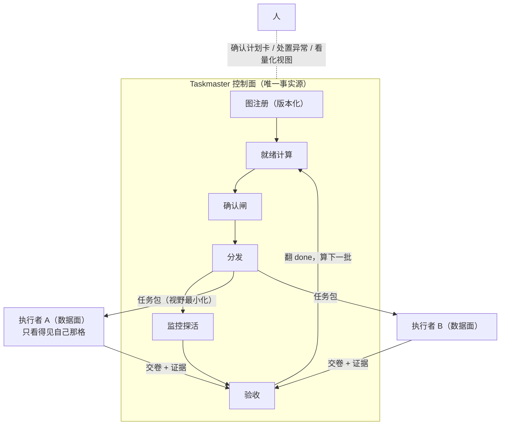
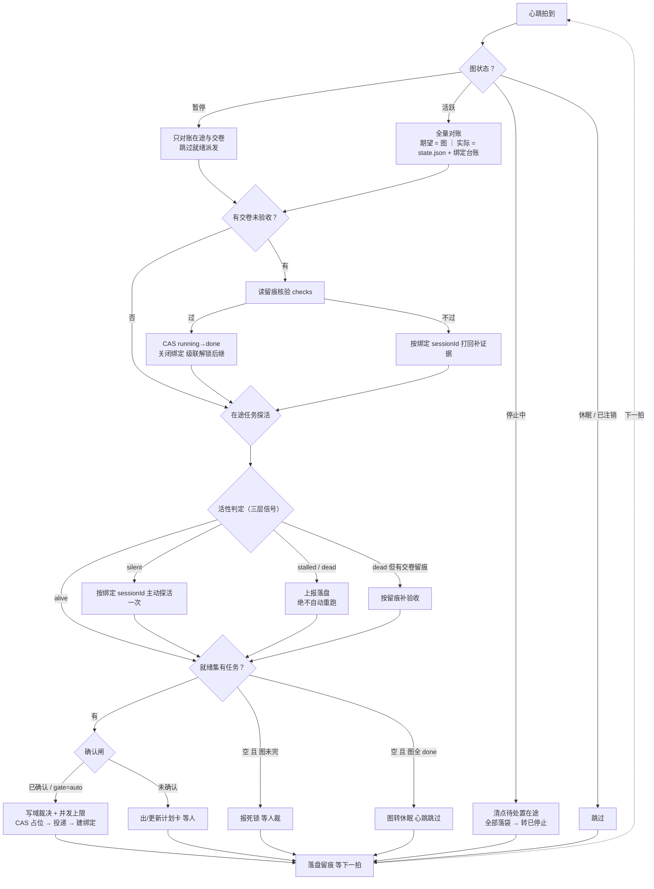
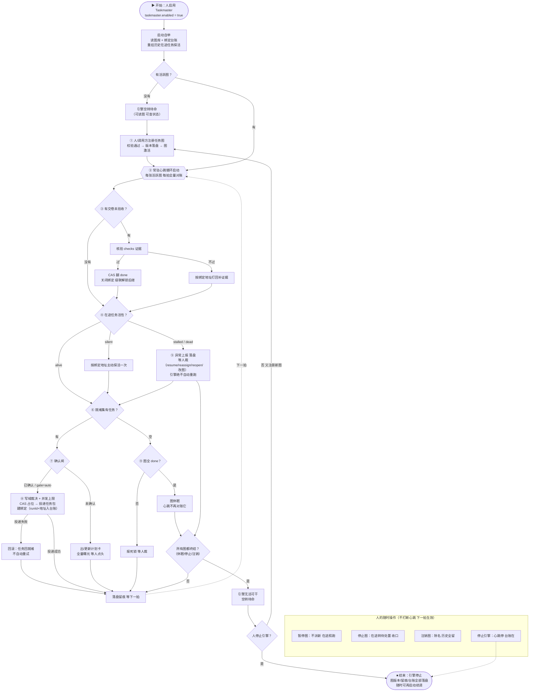

# Taskmaster（dsh-taskmaster）需求文档

（本文件是 PRD 的上游：回答「这批诉求成立吗、凭什么排在前面、哪些决定不做」。编号约定：`R-x`（本文）→ `FR-x` / `NFR-x`（PRD）。Taskmaster 是独立的 agent 任务调度引擎，与 Atomize 拆解插件无依赖关系。）

## 摘要

- **要解决什么**：把一组有依赖关系的 agent 任务交给一个常驻引擎，它按依赖顺序派活、盯活、验收、再派下一批，直到全部完成；人只在确认闸与异常点出现。图的暂停/停止/注销与引擎启停同样由人发起，引擎绝不自动重跑。
- **来源与证据强度**：单一需求方 2026-10-18 会话原话（"不会跳步""任务完成继续取任务""需要任务探活""像 Nacos 注册分发""像 K8s 调度一样""启动后工作都交给调度系统"）+ 同日生命周期与拓扑讨论；证据强度中。
- **本轮结论**：21 条进实现（R-1~R-13、R-17~R-24，S1/S2 两批）；延期 2 条（R-14 拉模式、R-15 网络面）；拒绝 1 条（R-16 自动重跑自修复）。v2.0（同日二轮）补入图/引擎全生命周期、绑定台账、拓扑约束与持久化原则。

## 背景与来源

- **收集方式**：需求会话多轮收敛（2026-10-18），从"派发盲区"到"driver 形式"到"控制面"到"常驻引擎"到"独立插件"到"全生命周期"逐步收窄。
- **样本**：单一需求方会话 1 场；参照：K8s controller（reconcile 循环）、Nacos（注册/发现/心跳）、DSH 自带 goal-round-driver（驱动器形态先例）。
- **排重结论**：DSH 已有 `@deepseek-ai/dsh-schedule`/`dsh-tool-schedule` 是**定时提醒**（cron 闹钟，按时间调度），Taskmaster 是**按依赖顺序调度 agent 任务**，零重叠。
- **架构原则（二轮收敛）**：引擎与执行者**身份独立**——引擎不依赖 agent 的身份与能力，agent 不知道引擎存在；两边只有三个接触面：任务包（视野最小化 + runId 世代凭据）、交卷（凭据 + checks 证据）、只读活性观察。引擎持有的是每个在途 run 的可达地址（绑定台账），不是执行者注册表。
- **原始记录**：[ADR-0001](../../adr/0001-scheduler-as-standalone-plugin.md)、[atomize-design.md](../../PRJ-0001/design/atomize-design.md)（引擎设计暂寄于此，PRJ-0002 设计文档待补）。

## 干系人与角色

| 角色 | 关注点 | 影响程度 | 决策权 |
|---|---|---|---|
| 需求方（项目所有者） | 不跳步、可监控、可量化、启动即交权 | 高 | 决策 |
| 属主窗口（人所在的会话） | 计划卡/确认闸/异常上报/人裁/视图的唯一落点 | 高 | 确认与人裁 |
| 执行者窗口（执行 agent，数据面） | 任务包视野最小化、判据明确、回合预算清楚；同时刻只挂一条活跃绑定 | 高 | 无（被调度方） |
| 管理层/观察方 | 进度量化、卡在哪、在等谁 | 中 | 知情 |
| 调用方插件（如 atomize） | 引擎 service 稳定、缺席可降级 | 中 | 建议 |

## 待解问题

| 问题 | 证据 | 影响 | 谁受影响 |
|---|---|---|---|
| 派发靠记得去调 | 工具是被动入口，不调不动 | 图落盘但执行断档 | 需求方 |
| 顺序靠自觉 | 先后依赖写在叙事里无强制 | 跳步，前驱未完后继开工 | 需求方、下游执行者 |
| 派出去就是盲区 | 会话原话："取任务后对任务没有监控" | 卡住/死掉无人知晓 | 需求方 |
| 完成靠嘴说 | 执行者说"做完了"就信 | 不合格产物流向下游 | 下游执行者、需求方 |
| 调度绑死发起会话 | 会话一关调度断 | 长任务不可靠 | 需求方 |
| 只有正向链路 | 图注册后无暂停/停止/注销，引擎无停止 | 错图/失控图无法收口 | 需求方 |
| 投递探活无寻址 | 引擎不知道任务绑在哪个会话上 | 探活/打回/重挂没有落点 | 需求方 |

## 假设与风险

| 假设 | 如果错了会怎样 | 证伪方式 | 结论 |
|---|---|---|---|
| 人愿意过确认闸（看计划卡点确认） | 闸太烦 → 需扩大 gate=auto 面 | M1 在 3~5 任务真实项目跑通，看驳回率 | 未验证 |
| host 插件级常驻引擎可行（goal-round-driver 先例） | 引擎形态不成立，退回纯工具 | M1 代码验证（语义层面已验证） | 未验证 |
| 探活三层信号足以判定卡死 | stalled 误判/漏判 | S2 卡死注入测试 | 未验证 |
| 单次 spawn 成本可被确认闸控制 | 派发爆炸烧算力 | 计划卡全量曝光 + 并发上限 | 部分成立 |

## 需求清单

| 编号 | 需求陈述 | 类型 | 优先级 | 状态 |
|---|---|---|---|---|
| R-1 | 接受校验通过的任务图注册（拒收有环图），版本只增不删，改图即新版本 | 功能 | Must | 待验证 |
| R-2 | 任何任务在全部前驱 done 之前不存在被派发的可能 | 功能 | Must | 待验证 |
| R-3 | 同批就绪任务可并行派发；写域重叠只放行先到者；并发有上限 | 功能 | Should | 待验证 |
| R-4 | 派发前出计划卡（预览/冲突/并发数），人确认才派；gate=auto 切面可免 | 功能 | Must | 待验证 |
| R-5 | 执行者只拿到本任务投影（陈述/前置产出/判据/写域/回合预算），读不到全图 | 功能 | Must | 待验证 |
| R-6 | 交卷必须带 checks 逐条证据，核验不过状态不变并打回 | 功能 | Must | 待验证 |
| R-7 | 在途任务有三层活性信号（心跳/回合/进程存活）与 alive→silent→stalled/dead 分级 | 功能 | Must | 待验证 |
| R-8 | stalled/dead/blocked/死锁只上报落盘，恢复动作全部由人发起，绝不自动重跑 | 约束 | Must | 待验证 |
| R-9 | 应用重启后就绪任务续派、在途任务按绑定台账重挂探活 | 质量属性 | Must | 待验证 |
| R-10 | 引擎常驻运行：心跳节拍全量对账并自主推进，启动即交权，不靠任何工具调用 | 功能 | Must | 待验证 |
| R-11 | 管理视图（kind/story/里程碑计数、波次、等待关系、燃尽、生命周期态）全部从图投影 | 功能 | Should | 待验证 |
| R-12 | taskmaster.enabled 开关与执行面降级（不可用退化为纯对话流） | 约束 | Must | 待验证 |
| R-13 | 任务投递：通道降级、runId 世代凭据、at-most-once、失败回滚、投递留痕、建/关绑定 | 功能 | Must | 待验证 |
| R-14 | 执行者轮询认领的拉模式 | 功能 | Won't | 已延期 |
| R-15 | 跨进程/跨机器外部执行者经 HTTP 面接入 | 功能 | Won't | 已延期 |
| R-16 | 异常自动重试/自动改图等自修复 | 功能 | Won't | 已拒（违反写操作安全纪律） |
| R-17 | 图级暂停/恢复：暂停不派新任务，在途照跑照验收照探活，可随时恢复 | 功能 | Must | 待验证 |
| R-18 | 图级停止：不派新 + 在途转待处置（不杀进程），全部落袋或人裁后进终态 | 功能 | Must | 待验证 |
| R-19 | 图级注销：移出活跃集，历史/版本/留痕全保留可查，不可逆 | 功能 | Must | 待验证 |
| R-20 | 在途绑定台账：四元组唯一 + 基数约束，投递/探活/打回/重挂的寻址依据 | 功能 | Must | 待验证 |
| R-21 | 拓扑约束：属主窗口:图=1:1；执行者窗口:图=N:1；窗口同时刻只服务一张图；引擎寿命独立于窗口 | 约束 | Must | 待验证 |
| R-22 | 持久化：图快照+事件流为事实源、投影可重建、append-only、原子写、单写者锁 | 质量属性 | Must | 待验证 |
| R-23 | 启动自举：宿主唤起 + enabled 开关 + Boot 五步，无手动启动入口 | 功能 | Must | 待验证 |
| R-24 | 引擎级停止：心跳停、在途不杀、台账保留，再启动可续 | 功能 | Should | 待验证 |

## 需求明细

#### R-1 任务图注册与版本

**描述**

引擎以注册的一张任务图（依赖图）为唯一调度依据；版本快照只增不删；在途执行按派发时快照跑完，新一批按新版本。术语为「任务图/任务」；调度语义是按依赖偏序推进，**注册校验拒收有环图**（环上任务互相等待，就绪集恒空，运行期才报死锁代价太大）。

**来源与证据**

需求会话"DAG 生成交给控制面然后分发出去"；设计文档数据模型节；二轮讨论「DAG/节点」放宽为「任务图/任务」的术语结论。

**验收判据**

注册 3 任务图后 `tm_status` 见 3 个 pending；upsert 修正版后旧版本可回读、在途任务不被中途换图；提交有环图被校验拒绝且不落盘。

**优先级理由**

没有注册与版本，引擎无事实源，其余需求全部无从谈起。

#### R-2 按依赖分发（不跳步）

**描述**

引擎只从"全部前驱 done"的任务中取活派发；前驱未 done 的任务在派发计划里不存在——无论触发来自工具、心跳对账还是重启续调。

**来源与证据**

会话原话"分配 agent 执行不会跳步""接口之间有顺序，数据库先建再写接口"。

**验收判据**

建表→接口→测试图中，建表未验收前任何路径都派不出接口任务（可由派发拒绝日志证伪）。

**优先级理由**

核心诉求；做不到则项目不成立。

#### R-3 并行与写域裁决

**描述**

同批就绪任务并行派发；写域重叠只放行先到者，其余在计划卡列出等人裁；并发数上限可配。**S1 并发上限固定为 1（串行派发），并行裁决 S2 才开**。

**来源与证据**

会话"页面拆成几个组件并行开发"；设计文档 write-scope-conflict。

**验收判据**

同批 3 个任务其中 2 个写域重叠 → 计划卡放行 2 个、列出 1 个冲突。

**优先级理由**

Should：一期可串行跑通，并行裁决随 S2 完善；语义先定，否则图没法拆细。

#### R-4 确认闸（计划卡）

**描述**

派发前出计划卡：本批任务预览、写域冲突、并发数；人确认才真派，不带确认永不派发；里程碑 gate=auto 切面内免确认。

**来源与证据**

会话对"自主但不失控"的明确要求；设计文档三道闸之闸3。

**验收判据**

不带 confirm 的调度触发只产生计划卡，零 spawn。

**优先级理由**

spawn = 真实算力与业务写入，闸是成本与安全的唯一控制点。

#### R-5 任务包视野最小化

**描述**

执行者的初始上下文只含本任务投影：任务陈述、前置产出（大产物只给路径+摘要）、验收判据、写域约束、回合预算；读不到全图。视野最小化由架构保证：任一执行者窗口同时刻只挂一条活跃绑定（见 R-20/R-21）。

**来源与证据**

会话"派发时每格只给该给的上下文，前置产出在 DAG 里"。

**验收判据**

检查任一执行会话初始上下文，不含非入边任务的信息。

**优先级理由**

上下文污染是跳步与越权写的前因；视野最小化由架构保证而非约定。

#### R-6 完成验收

**描述**

交卷必须带 checks 逐条证据；引擎核验（机械部分）通过才 CAS 翻 done；不过打回补证据、状态不变。打回通知经绑定台账的 sessionId 寻址送达（见 R-20）。

**来源与证据**

待解问题"完成靠嘴说"；设计文档 tm_node_update evidence-insufficient。

**验收判据**

证据缺失的 complete 被拒收，任务保持 running，执行者收到补充要求。

**优先级理由**

验收是"完成→解锁下一批"闭环的信任锚点；没有它闭环越快错得越快。

#### R-7 在途监控与探活

**描述**

每个 running 任务有三层活性信号：留痕心跳（events seq 增长）、回合预算消耗、执行者进程存活；分级 alive → silent（主动探活一次）→ stalled（报人）；进程消失为 dead（按留痕补验收，补不上报人）。活性是投影，不进主状态机。主动探活与打回通知都经绑定台账的 sessionId 寻址（见 R-20）。

**来源与证据**

会话原话："我们需要一个任务探活能力""任务完成让继续去取任务"。

**验收判据**

人为停掉一个执行者（idle 不交卷），一个巡检周期内被标 stalled 并上报。

**优先级理由**

监控是把"派发"变"闭环"缺的那条弧；没有它引擎就是盲发。

#### R-8 异常只报不修

**描述**

stalled/dead/blocked/死锁（就绪集空但图未完）的唯一动作是上报 + 落盘；resume/reassign/reopen/改图全部由人发起；绝不自动重跑写操作。人裁重派必须签发新世代 runId，旧世代回话拒收。

**来源与证据**

设计文档失败模式表；写操作安全纪律。

**验收判据**

构造死锁图，引擎巡检报出死锁且不采取任何派发动作。

**优先级理由**

约束性需求：自动重跑写操作一旦出事不可逆，红线先立。

#### R-9 重启续调与在途重挂

**描述**

应用重启后：就绪任务继续可派；running 任务按落盘绑定台账（runId/sessionId/startedAt/最后事件 seq，见 R-20）重挂探活——已完成的补验收、活着的重新订阅、断气的标 stalled。窗口死亡语义见 R-21：属主窗口关闭排队补投，执行者窗口死亡按 dead 流程处置。

**来源与证据**

设计文档 NFR-1；本地工具最差场景是 state.json 损坏可从快照重建（R-22 持久化原则）。

**验收判据**

接口任务 running 时 kill 应用，重启后：前驱保持 done、在途被重挂或如实标 stalled、后继不提前派发。

**优先级理由**

长任务跨会话跨重启是常态；不续调的引擎不可用。

#### R-10 常驻对账循环（引擎形态）

**描述**

引擎启动后常驻运行：按心跳节拍对活跃图做全量对账（期望 = 图，实际 = state.json + 绑定台账），自主完成派发、催办、验收、图完成判定；事件只是即时加速，心跳是兜底——事件丢失、会话关闭，下一拍照样把账对回来。**启动即交权**：图注册激活后干活的全是引擎，人只在确认闸与异常点出现。

**来源与证据**

会话原话："调度系统和 driver 一样一直让 agent 完成工作，也有心跳，检查自己的图都完成没、是否继续排放任务""不是工具性质的""启动调度系统以后工作应该都交给调度系统来干活"。

**验收判据**

注册图后不做任何工具调用，一个心跳节拍内自动出计划卡；模拟丢失一次完成事件，下一拍心跳仍正确对账推进。

**优先级理由**

引擎与工具的分界线；若是工具形态，R-2/R-7/R-9 全部退化为"靠人记得调"。

#### R-11 量化视图

**描述**

管理视图从图投影：kind/story/里程碑计数、波次、等待关系、燃尽点数；单点详情含活性投影；**视图必须呈现图生命周期态（活跃/暂停/停止中/已停止/休眠/已注销）与任务待处置态**；无第二事实源。

**来源与证据**

会话"管理层能看到：改多少个接口、多少页面组件；量化清单是有顺序的"。

**验收判据**

`tm_status group_by=kind` 计数与图文件一致；未就绪项显示"在等谁"；暂停中/已注销的图在视图中如实标注。

**优先级理由**

Should：S1 出基础投影即可，燃尽等增强后置。

#### R-12 开关与降级

**描述**

`taskmaster.enabled=false`：不派发不探活，读写照常；执行面不可用降级为纯对话流（只出计划卡）。

**来源与证据**

设计文档失败模式与回滚节。

**验收判据**

关开关后触发调度零 spawn 且能正常读图。

**优先级理由**

新能力的标配安全阀，Must。

#### R-13 任务投递（delivery）

**描述**

引擎经宿主执行面把任务包投递给执行者：通道按可用性降级（startActivation / window branch / spawnTeammate / 纯对话流）；载荷含 runId 世代凭据与本任务投影；投递 at-most-once，失败回滚不自动重试，每次投递尝试（含失败）留痕；回话只认当前世代 runId。**投递成功即建绑定、任务终态即关绑定**（见 R-20）；属主窗口关闭期间计划卡/上报落盘排队、重开补投；执行者窗口死亡按 dead 流程（R-7）处置。

**来源与证据**

会话原话："没看到驱动投递任务的能力"——投递作为独立能力必须成文。

**验收判据**

投递失败的任务回到就绪且无执行者残留；同一任务同世代最多一个在途 run（构造并发触发验证不重复派发）；每次投递尝试在 runs/ 下有留痕。

**优先级理由**

没有成文的投递语义，R-2 与 R-5 在执行面落地时各写各的，闭环断在最后一厘米。

#### R-14 拉模式认领（已延期）

**描述**

执行者主动轮询引擎认领任务，而非引擎推送 spawn。

**来源与证据**

Nacos 类比讨论的衍生（推送/轮询双模式）。

**验收判据**

（延期，一期不验证）二期若启用：执行者注册能力后可拉到匹配任务。

**优先级理由**

一期推模式已够；拉模式引入认领竞争与超时回收复杂度，不在正确性关键路径。

#### R-15 网络面外部执行者（已延期）

**描述**

跨进程/跨机器执行者经 host HTTP 面接入引擎。

**来源与证据**

设计文档开放问题"控制面网络面"。

**验收判据**

（延期，一期不验证）二期若启用：外部进程可注册、领任务、回传证据。

**优先级理由**

一期是本地工具进程内 service；接口按控制面/数据面划清后二期可平滑加网络面，现在做是过度设计。

#### R-16 异常自动重跑/自修复（已拒）

**描述**

stalled/dead 任务由引擎自动重跑，或验收失败自动改图。

**来源与证据**

设计讨论中被明确排除的方向。

**验收判据**

（已拒，不验证）反向判据：任何异常路径下引擎不产生新的 spawn。

**优先级理由**

写操作不幂等，自动重放可能造成不可逆业务写入；永久拒绝。

#### R-17 图级暂停与恢复

**描述**

任一活跃图可被人暂停：暂停期间引擎照常对账、照常验收交卷、照常探活在途任务，但就绪集不再出计划卡、不再派发新任务；恢复后下一拍正常续派。暂停/恢复只改调度行为，不改图内容、不改任务状态。

**来源与证据**

2026-10-18 生命周期讨论："可以停止、注销等能力"；待解问题"只有正向链路"。

**验收判据**

活跃图存在就绪任务时发起暂停：零新计划卡；在途任务交卷照常被验收；恢复后一个节拍内正常出计划卡。

**优先级理由**

没有暂停，人想"先别派了让我看看"只能关总开关，误伤同引擎的其他图；暂停是反向控制三档中最轻的一档。

#### R-18 图级停止

**描述**

人发起停止：图不再派新任务，在途任务转"待处置"——**不杀进程**，可继续交卷验收，但完成不再触发后继派发；全部在途落袋（done/人裁）后图进"已停止"终态。终态可查不可恢复，要重跑须注册新版本。

**来源与证据**

2026-10-18 生命周期讨论：暂停/停止/注销三档分立的决议。

**验收判据**

有 2 个在途任务的图发起停止：零新派发；在途交卷照常验收但后继不解锁；两个在途全部落袋后图状态=已停止，心跳跳过该图。

**优先级理由**

停止是"收口"语义：给错图/失控图一个温柔的下车方式——在途工作不白费，后继不会再开。

#### R-19 图级注销

**描述**

人发起注销：图立即移出活跃集，心跳跳过；尚未清零的在途绑定全部按失联处置并上报人裁（推荐路径是先停止再注销）；图的版本快照、事件流、runs/ 留痕**全部保留可查**；注销**不可逆**。

**来源与证据**

2026-10-18 生命周期讨论；"版本只增不删"纪律的延伸。

**验收判据**

注销后心跳不再对账该图；`tm_status` 仍可查其历史版本与留痕；系统中不存在注销图的恢复入口。

**优先级理由**

除名不删史，与 R-1 同源；不可逆是为了防止"误注销—恢复"造成的归属含糊——要重来就注册新版本，语义干净。

#### R-20 在途绑定台账

**描述**

每次投递成功建立一条绑定记录：**(graphId, 图版本, taskId, runId 世代) 四元组唯一**，另含 sessionId/通道/dispatchedAt/startedAt/lastEventSeq。台账是探活、打回通知、dead 判定、重启重挂的**唯一寻址依据**。基数约束：一个任务同时刻最多一条活跃绑定（CAS 占位保证）；同一 sessionId 不出现在两条活跃绑定中；任务终态绑定关闭（runs/ 留痕永久保留）。

**来源与证据**

2026-10-18 讨论："Taskmaster 应该记录绑定到那个 agent 上吧，要不怎么投递消息"；R-9 监控元数据需求的成文化。

**验收判据**

任一 running 任务在台账中可查到完整绑定记录；打回/探活消息经台账 sessionId 送达；任务 done 后绑定关闭且 runs/ 留痕仍可查；人裁重派生成新世代绑定，旧 runId 回话被拒收。

**优先级理由**

没有台账，R-7/R-9/R-13 在执行面落地时无寻址依据，各写各的——闭环断在最后一厘米的另一种死法。

#### R-21 拓扑约束（窗口/引擎/图）

**描述**

**属主窗口:图 = 1:1**——计划卡、确认闸、异常上报、人裁入口、量化视图的唯一落点；**执行者窗口:图 = N:1**——并行派发开多个执行者窗口，每个窗口同时刻仅挂一条活跃绑定；**任何窗口同时刻只服务一张图**。引擎实例:图 = 1:1，引擎寿命独立于一切窗口：属主窗口关闭→待人事项落盘排队、重开补投；执行者窗口死亡→按 dead 流程处置。**同一数据根多写者是红线**（单写者锁物理保证，见 R-22）；异数据根多引擎允许，前提是图间写域不相交。

**来源与证据**

2026-10-18 拓扑讨论："一个窗口对应一个图""图可以对应多个窗口""两张图不会相交"。

**验收判据**

图并行派发 3 个任务 → 3 个执行者窗口各挂一条绑定；属主窗口关闭重开后能补看到关门期间的计划卡与上报；同一数据根上起第二个引擎实例被单写者锁拒绝。

**优先级理由**

拓扑不定，确认闸/上报/人裁的落点全是悬空的；"调度绑死发起会话"这条待解问题也靠它收口。

#### R-22 持久化

**描述**

**图版本快照 + 事件流（append-only，seq 单调递增）是唯一事实源**；state.json 与绑定台账是可重建投影；所有原地写走"临时文件 + 原子 rename + 版本号 CAS"；数据根持单写者锁防止双引擎写同一数据根；一期不引入数据库。崩溃恢复 = 图快照 + 事件重放，不信任任何单个状态文件。

**来源与证据**

2026-10-18 持久化设计讨论；R-9 原有"state.json 损坏可从快照重建"的扩展。

**验收判据**

删除 state.json 后重启：引擎从图快照 + 事件流完整重建任务状态；事件流每条记录带单调 seq（探活"留痕心跳"信号同源）；锁文件存活期间第二个写者进程拒绝启动并如实报错。

**优先级理由**

常驻引擎的可靠性全压在持久化纪律上；事实源唯一，才能做到"投影崩了不心疼"。

#### R-23 启动自举

**描述**

引擎**无手动启动入口**：宿主插件唤起 → 读 `taskmaster.enabled` → false 进 Disabled（读写照常）/ true 进 Boot 五步——① 加载配置（节拍/TTL/并发上限/gate 切面）→ ② 扫描图库校验每张图元数据（生命周期态）→ ③ 图快照 + 事件流重建状态投影 → ④ 读绑定台账逐一对在途 run 处置（已交卷补验收 / 活着重订阅探活 / 死了标 stalled 报人）→ ⑤ 进入常驻心跳循环。

**来源与证据**

2026-10-18 讨论"taskmaster 开始是如何开启"；"启动即交权"（R-10）的另一半。

**验收判据**

enabled=true 重启应用：无人介入情况下 Boot 五步按序执行，在途任务被重挂或如实标 stalled，之后一个节拍内正常出计划卡。

**优先级理由**

人的唯一动作是开开关，之后全自动——这是"启动即交权"成立的物理路径。

#### R-24 引擎级停止

**描述**

人可停止整个引擎：心跳停、零派发零探活；在途任务不杀、绑定台账保留；再启动时按 Boot 第 ④ 步重挂续盯。与 R-12 禁用的区别：**禁用是配置态（我不想用它），停止是运行态（先别干了，账还在）**。

**来源与证据**

2026-10-18 生命周期讨论（引擎状态机 Stopped 态）。

**验收判据**

引擎停止期间：零心跳零派发；在途 agent 的交卷落盘不丢；再启动后补验收、正常续调。

**优先级理由**

Should：一期可用禁用开关近似替代但语义含糊（禁用后再启用与停止后再启动的恢复路径不同），S2 补齐。

## 优先级与排序

| 排序方法 | 判据 | 本轮结论 |
|---|---|---|
| MoSCoW | 缺了它核心场景是否跑不通 / 是否安全红线 | Must：R-1/2/4/5/6/7/8/9/10/12/13/17/18/19/20/21/22/23；Should：R-3/11/24；Won't：R-14/15/16 |

排序即交付批次：**S1（M1）** = R-1/2/4/5/6/9/10/12/13/17/18/19/20/21/22/23 + R-7 被动心跳 + R-11 基础投影（**S1 并发上限固定为 1，串行派发**）；**S2（M2）** = R-3 完善（并行与写域裁决）+ R-7 主动探活与沉默分级 + R-8 死锁巡检 + R-24 引擎级停止。

## 需求验证

| 需求编号 | 验证方式 | 结论 | 验证人 |
|---|---|---|---|
| R-1~R-13 | M1 三任务示例图端到端走查（核心场景） | 待验证 | 待定 |
| R-7/R-8 | S2 卡死与死锁注入测试 | 待验证 | 待定 |
| R-2 | 派发拒绝日志走查 | 待验证 | 待定 |
| R-10 | 丢事件注入（回调不到达，看下一拍对账） | 待验证 | 待定 |
| R-12 | 关开关零 spawn 走查 | 待验证 | 待定 |
| R-13 | 投递失败注入（回滚/不重试/留痕）；并发触发不重复派发 | 待验证 | 待定 |
| R-17~R-19 | 图生命周期走查（暂停→恢复；停止→收口；注销→查史） | 待验证 | 待定 |
| R-20 | 台账字段核对 + 探活/打回寻址走查 + 世代拒收验证 | 待验证 | 待定 |
| R-21 | 拓扑构造验证（并行开窗/属主关门补投/双写者锁拒） | 待验证 | 待定 |
| R-22 | 崩溃重建演练（删 state.json 重启，状态完整恢复） | 待验证 | 待定 |
| R-23/R-24 | 启停走查（Boot 五步顺序；引擎停止续调） | 待验证 | 待定 |

## 变更控制

- **基线**：本文件 v1.0 定于 2026-10-18（自 atomize-scheduler-requirements 独立为 Taskmaster 专项）；基线之后的新增一律走本表。

| 日期 | 变更 | 谁提的 | 决策 | 影响 |
|---|---|---|---|---|
| 2026-10-18 | 新建 Taskmaster 需求池，R-1~R-16 入池（承接并取代 atomize-scheduler-requirements） | 需求方会话 | 接受（13 条）/延期（2 条）/拒（1 条） | 旧文档标记废止；PRJ-0002 设计文档待补 |
| 2026-10-18 | v2.0：新增 R-17~R-24（图/引擎生命周期、绑定台账、拓扑约束、持久化、启动自举）；修订 R-1（无环校验+术语）/R-6/R-7/R-9/R-11/R-13（绑定台账寻址与窗口死亡语义）；干系人 +2（属主窗口/执行者窗口）；待解问题 +2；开放问题 +1；附录图替换 + 新增全生命周期总图；正文「节点」措辞统一为「任务」（会话原话引用保留） | 需求方会话（生命周期与拓扑二轮讨论） | 接受（8 条新增：7 Must + 1 Should） | S1 范围扩大为含 R-17~R-23；R-24 排 S2；PRJ-0002 设计文档须覆盖新增条目 |

## 与 PRD 的映射

（PRD 已立：[taskmaster-prd.md](../prd/taskmaster-prd.md) v0.1；设计文档：[taskmaster-design.md](../design/taskmaster-design.md) v0.1。映射规则：类型=功能 → FR；类型=约束/质量属性 → NFR。）

| 需求编号 | PRD 需求编号 | 状态 |
|---|---|---|
| R-1 | FR-1 | 已覆盖 |
| R-2 | FR-2 | 已覆盖 |
| R-3 | FR-3 | 已覆盖（S2） |
| R-4 | FR-4 | 已覆盖 |
| R-5 | FR-5 | 已覆盖 |
| R-6 | FR-6 | 已覆盖 |
| R-7 | FR-7 | 已覆盖 |
| R-8 | NFR-1 | 已覆盖 |
| R-9 | NFR-2 | 已覆盖 |
| R-10 | FR-8 | 已覆盖 |
| R-11 | FR-9 | 已覆盖（燃尽后置） |
| R-12 | NFR-3 | 已覆盖 |
| R-13 | FR-10 | 已覆盖 |
| R-14 | 无（开放问题：推/拉模式） | 已延期 |
| R-15 | 无（开放问题：网络面） | 已延期 |
| R-16 | 无（PRD 非目标） | 已拒 |
| R-17 | FR-11 | 已覆盖 |
| R-18 | FR-12 | 已覆盖 |
| R-19 | FR-13 | 已覆盖 |
| R-20 | FR-14 | 已覆盖 |
| R-21 | NFR-4 | 已覆盖 |
| R-22 | NFR-5 | 已覆盖 |
| R-23 | FR-15 | 已覆盖 |
| R-24 | FR-16 | 已覆盖（S2） |

## 开放问题

| 问题 | 选项 | 负责人 | 截止 |
|---|---|---|---|
| 确认闸的交互形态 | A 计划卡投属主会话等 confirm / B 独立审批 UI | 待定 | S1 评审 |
| 执行者来源 | A 每次 spawn 新 agent / B 执行者池注册认领 | 待定 | S2 前 |
| 验收的机械边界 | checks 里哪些可机械核验、哪些必须人看 | 待定 | S1 评审 |
| 心跳节拍时长与 TTL | A 固定配置 / B 按图可配（建议：全局默认 + 图级覆盖 + 上下限钳制） | 待定 | S1 评审 |
| 跨引擎/跨图写域协调 | A 共享裁决服务 / B 写域注册表 | 待定 | 二期（与 R-15 同批） |

## 附录

- **原始记录**：2026-10-18 需求会话多轮收敛；本文件承接并取代 [atomize-scheduler-requirements.md](../../PRJ-0001/requirement/atomize-scheduler-requirements.md)（已废止）。
- **附图 1：控制面 / 数据面架构**

- **附图 2：常驻心跳对账循环（v2.0：图状态分流 + 绑定台账寻址 + dead 补验收 + 死锁支路）**

- **附图 3：Taskmaster 全生命周期总图（开始 → 结束）**

- **核心场景（M1 出口判据走查脚本）**：注册 3 任务图（建表→接口→测试）→ 计划卡确认派建表 → 模拟卡死标 stalled 报人 → 人裁 resume → 交卷验收过 → 自动出下一批计划卡派接口 → 证据缺失拒收打回 → 补齐过 → 派测试 → 图完成；中途验证：关开关零 spawn（R-12）；构造一次投递失败验证回滚与留痕（R-13）；暂停→恢复、停止→收口、注销→查史走查（R-17~R-19）；kill 应用重验续调：不重复、不跳步、在途经绑定台账重挂（R-9/R-20/R-23）。
- **相关文档**：[ADR-0001 调度驱动器独立为插件](../../adr/0001-scheduler-as-standalone-plugin.md)、[atomize-design.md](../../PRJ-0001/design/atomize-design.md)（引擎设计暂寄，PRJ-0002 设计文档待补）。
- **变更历史**：v1.0 首版（2026-10-18，自 atomize-scheduler-requirements 独立，引擎定名 Taskmaster，工具前缀 `tm_*`）；v2.0（2026-10-18，生命周期/绑定台账/拓扑/持久化二轮收敛，R-17~R-24 入池，附图 2 替换、附图 3 新增）。
